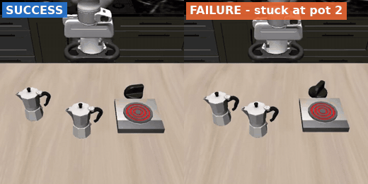
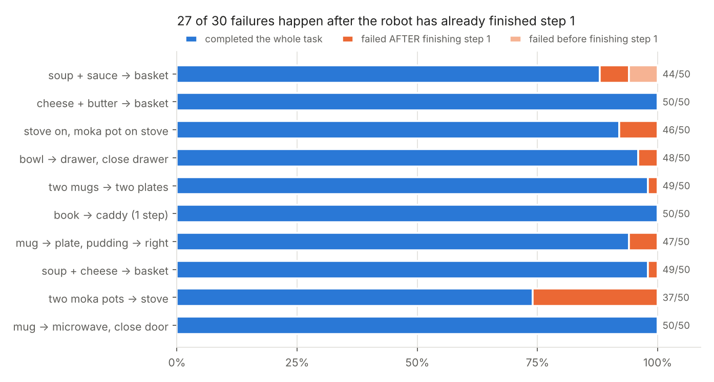
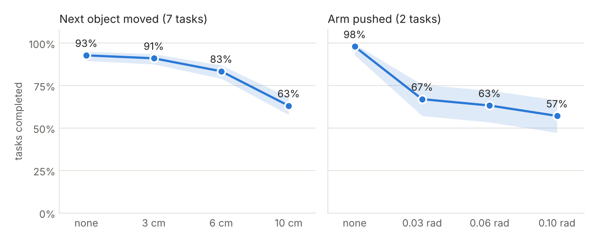
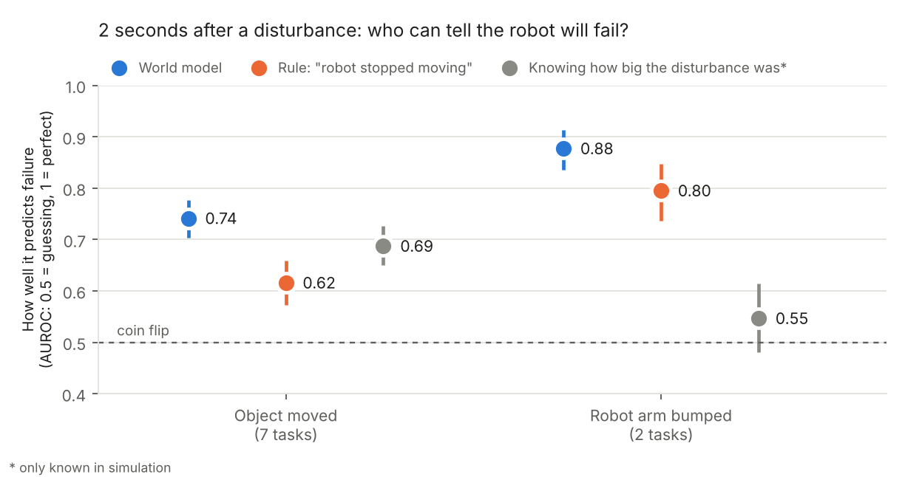

# vla-long-horizon

Where does a vision-language-action (VLA) policy fail on multi-step tasks, and can a small world model notice it early?

I evaluated π0.5 (`lerobot/pi05_libero_finetuned`) on the 10 long-horizon tasks of LIBERO-10 in simulation. The model gets camera images and an instruction such as "put both moka pots on the stove" and outputs arm actions. I added logging so that every sub-goal of a task is checked at every step, not just the final success.

  

Same task, 2× speed. Right: the first pot is placed, then the arm stays next to the second pot until time runs out.

## Results

**Baseline.** 470 of 500 episodes succeed (94%). 27 of the 30 failures happen after the first sub-goal is already done. Most of them are on "put both moka pots on the stove": in all 13 failures there, the first pot is placed and the robot then gets stuck at the second one.

**Disturbances.** I moved the object needed for the next step, or pushed the arm, right after the first sub-goal was reached. Small changes (3 cm) don't matter. Moving the object by 10 cm drops success from 93% to 63%. Pushing the arm while it closes a drawer or microwave door drops it from 98% to 57–67%.

**Early warning.** I trained a small dynamics model (MLP) on successful runs only. It predicts the next state from the current state and the next actions. When the prediction error gets large, something is going wrong. Two seconds after a disturbance it separates failures from successes with AUROC 0.74 (object moved) and 0.88 (arm pushed). A simple "the robot stopped moving" rule gets 0.62 and 0.80.

It does not work everywhere. On the moka pot task it is close to chance (AUROC ≈ 0.6), and on the few natural failures without any disturbance (11 in the held-out runs) the result is unclear (AUROC 0.56, confidence interval 0.40 to 0.73).

## Notes

- My first evaluation of the unperturbed case reported AUROC 0.70. That number was wrong: some of the test episodes were also in the training set. After restricting the test set to unseen initial states, it dropped to 0.56.
- Teleporting objects in MuJoCo sometimes makes the physics explode. 14 of about 1,340 perturbed episodes had an object jump more than 15 cm in one step, and I excluded them. My first filter also caught objects that were simply falling into a basket, so it now only looks at jumps after the perturbation.
- The world model uses the exact object positions from the simulator. A real robot would have to estimate them from the cameras.

## Limitations

- Simulation only, one model, one random seed.
- The monitor only detects problems. I have not tested acting on the warning, for example by retrying the current step.

Next things I want to try: a world model on image features instead of simulator state, and actually retrying or re-planning when the warning fires to see how much success comes back.

## More

Method, all numbers with confidence intervals, sanity checks and how to reproduce: [docs/TECHNICAL.md](docs/TECHNICAL.md).

Built on [LeRobot](https://github.com/huggingface/lerobot) and [LIBERO](https://github.com/Lifelong-Robot-Learning/LIBERO).
