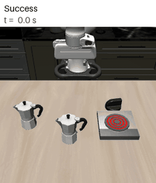
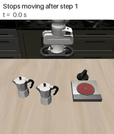
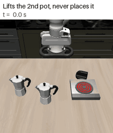
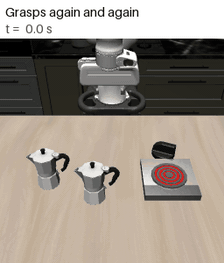
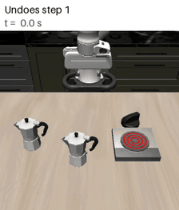
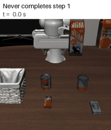
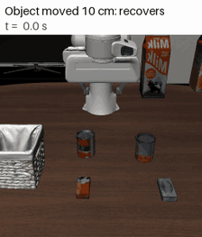
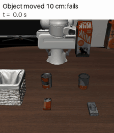
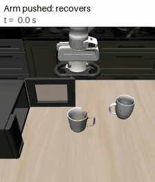
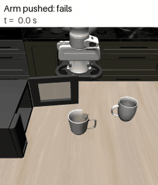

# vla-long-horizon

Where does a VLA policy fail on multi-step tasks, and can a small world model notice it early?

I ran π0.5 (`lerobot/pi05_libero_finetuned`) on the 10 tasks of LIBERO-10 (50 episodes each) and logged which sub-goals were satisfied at every step, not only the final success.

## Failures come after step 1

470 of 500 episodes succeed. 27 of the 30 failures happen after the first sub-goal was already completed, almost half of them on the moka pot task.

What these failures look like (moka pot task unless noted; number = failures with this pattern, a failure can have several):

| | | |
|:---:|:---:|:---:|
|  success, for comparison |  stops moving after step 1 (16) |  lifts the 2nd pot, never places it (6) |
|  grasps again and again (5) |  undoes step 1 (4) |  never completes step 1 (3, basket task) |

## Disturbances after step 1

Right after the first sub-goal, I either moved the object needed for the next step or added noise to the arm joints. Moving the object by 10 cm drops success from 93% to 63%. Even the smallest arm push drops it from 98% to 67%.

| | recovers | fails |
|---|:---:|:---:|
| tomato sauce moved 10 cm |  |  |
| arm pushed after the mug is in the microwave |  |  |

## Early warning with a world model

An MLP trained on successful runs only predicts the next state from the current state and the next 10 actions. A large prediction error means the episode is going off track. Two seconds after the disturbance this predicts failure better than a "robot stopped moving" rule:

On the moka pot task alone it is close to guessing (AUROC 0.61), and for the 11 failures without any disturbance in the held-out runs the result is inconclusive (0.56, CI 0.40 to 0.73).

## Notes

- A first version of the unperturbed evaluation gave AUROC 0.70 because some test episodes were also in the training set. Restricting the test set to unseen initial states gave 0.56.
- 14 of about 1,340 perturbed episodes were excluded because the moved object jumped more than 15 cm in one simulation step.
- The GIFs replay the logged actions; they are not new runs. Eight match the log exactly, two drift by up to 9 mm with the same outcome (`docs/behaviors/episodes.json`).
- The world model uses exact object positions from the simulator, which a real robot would not have.
- One model, one seed, simulation only. I have not yet tested acting on the warning.

Method, all numbers with confidence intervals and how to reproduce: [docs/TECHNICAL.md](docs/TECHNICAL.md). Built on [LeRobot](https://github.com/huggingface/lerobot) and [LIBERO](https://github.com/Lifelong-Robot-Learning/LIBERO).
