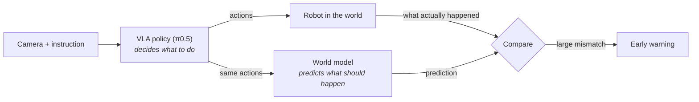

# When does a robot fail a multi-step task, and can we see it coming?

I tested **π0.5**, an open robot foundation model, on 10 multi-step household
tasks in simulation (**2,500+ episodes**). π0.5 is a
*vision-language-action (VLA)* model: it looks at camera images, reads an
instruction such as *"put both moka pots on the stove"*, and moves the arm.

  

Same task, same model, 2× speed. Right: the first pot is placed, then the arm hovers next to the second pot until time runs out.

## In 30 seconds

| | What I found |
|---|---|
| **1** | **9 out of 10 failures happen after the robot has already finished step 1.** Starting a task is easy; continuing it is where things go wrong. |
| **2** | **If the object needed for step 2 is moved by 10 cm, the robot finishes only 63% of tasks** (93% without the disturbance). |
| **3** | **A small world model, trained only on successful runs, gives an early warning 2 seconds after a disturbance.** It predicts failure better than a simple "the robot stopped moving" rule, though not perfectly. |

## The idea

A VLA only learned **what to do**, by copying human demonstrations. It never
learned **what will happen** after it acts, so once something goes off-script it
has no notion that it is failing. A *world model* adds exactly that: it predicts
the next state from the current state and the planned actions. When reality
stops matching the prediction, that mismatch is a warning signal.

## Results

### 1. Failures hide in the later steps

An overall score of 94% looks solved. Logging every sub-goal shows that the
remaining failures are concentrated in the second half of tasks, especially
*"two moka pots → stove"*. In all 13 failures of that task the first pot was
placed and the robot then got stuck on the second one, with time to spare.

### 2. The robot struggles to recover from a mid-task disturbance

Small changes (3 cm) are absorbed. Larger ones are not. Bumping the arm while it
closes a drawer or a microwave door drops success from 98% to 57–67%.

### 3. A world model gives an earlier warning

The world model sees trouble coming sooner than a stall rule.
It is not perfect: on the hardest task (two moka pots) it is only slightly
better than chance, which is the obvious next thing to improve.

## Why this matters for real robots

* **One success number is not enough.** Benchmarks such as LIBERO are close to
  saturated; sub-goal-level evaluation shows *where* a policy breaks.
* **Robustness after step 1 is the long-horizon problem.** Factory and household
  tasks are chains of steps, and a small slip early on compounds later.
* **A monitor needs no retraining of the robot model.** It could sit next to any
  VLA as a pluggable safety layer and trigger a retry, a re-plan, or a stop
  (not tested yet, see below).

## Honest limits

* Simulation only, one model, one random seed.
* The world model uses the simulator's exact object positions. A real robot
  would have to estimate them from cameras.
* The monitor only *detects* problems; I have not yet tested acting on its warning.

## What I would do next

1. **Visual world model:** predict in image-feature space (e.g. DINO features),
   so the monitor only uses what the robot sees.
2. **Close the loop:** when the warning fires, retry the current sub-step or
   re-plan, and measure how much success is recovered.
3. **Longer and harder tasks:** more steps, perturbation benchmarks such as
   LIBERO-plus, and eventually a real robot.

---

**Technical report** (method, all numbers with confidence intervals, sanity
checks, how to reproduce): [docs/TECHNICAL.md](docs/TECHNICAL.md)

**Code:** `vlalh/instrument.py` (step-level logging and perturbations on top of
[LeRobot](https://github.com/huggingface/lerobot)), `vlalh/world_model.py`
(world model), `analysis/` (all figures and statistics).

**Author:** Haoxiang Gao

Built on [LeRobot](https://github.com/huggingface/lerobot),
[LIBERO](https://github.com/Lifelong-Robot-Learning/LIBERO) and the
`lerobot/pi05_libero_finetuned` checkpoint.
