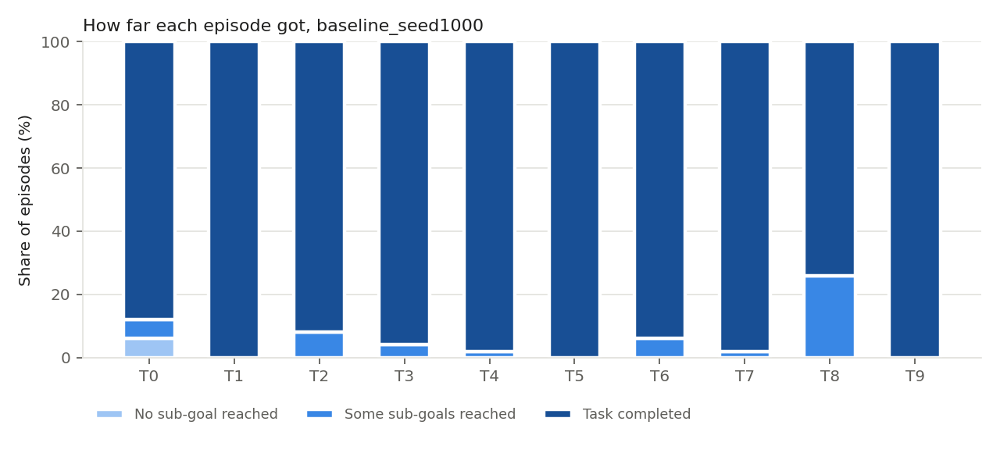

# Where do VLAs fail on long-horizon tasks?

Stage-level evaluation of a Vision-Language-Action policy (π0.5) on LIBERO-10,
with mid-episode perturbations, as a starting point for asking whether a
lightweight world model can see failures coming.

> **Status:** work in progress. All numbers below come from actual runs; nothing
> is extrapolated. Parts 1 and 2 are done; Part 3 (acting on the monitor) is next.

## Motivation

On LIBERO, released VLA checkpoints are close to saturation (π0.5 reports ~96%
on LIBERO-10). An aggregate success rate does not say *where* in a multi-step task
a policy fails, or whether it can *recover* after something goes wrong mid-task.
Both matter for long-horizon action generation.

This repo therefore evaluates at the level of **sub-goals**: every LIBERO task
goal is a conjunction of BDDL predicates (e.g. `(In alphabet_soup basket)` ∧
`(In tomato_sauce basket)`), and we log the truth value of each predicate at
every simulation step.

## What is measured

| Part | Question | Status |
|---|---|---|
| 1. Stage-level baseline | Per-sub-goal completion, time to each sub-goal, P(success \| first sub-goal reached) | done (1 seed) |
| 1b. Mid-episode perturbation | After the first sub-goal is done, shift the next target object (or perturb the arm). How often does the policy still finish? | done (1 seed, 3 magnitudes) |
| 2. World-model failure monitor | Train a small action-conditioned dynamics model on successful rollouts; does its prediction residual flag failures early? (AUROC vs decision time) | done (state-based) |
| 3. Residual-triggered retry | Re-issue the current sub-instruction when the monitor fires | stretch |

## Setup

* Policy: `lerobot/pi05_libero_finetuned` via [LeRobot](https://github.com/huggingface/lerobot)
* Benchmark: LIBERO-10 (Long), 10 tasks, LeRobot's fixed init states
* Hardware: single RTX 5080 (16 GB), Ubuntu, `MUJOCO_GL=egl`
* `--policy.n_action_steps=10`, `--policy.compile_model=false`, `--eval.batch_size=1`

## How it works

`vlalh/instrument.py` monkey-patches LeRobot's `LiberoEnv` (reset/step/close)
so the stock `lerobot-eval` loop is used unchanged. Per episode it writes

* `summary.jsonl` – one line per episode: success, first step each predicate
  became true, whether/when/how it was perturbed
* `episodes/taskXX_initYYY.npz` – per-step predicates, end-effector pose,
  gripper, joint positions, goal-object poses, actions

Perturbation (env vars):

| Variable | Meaning |
|---|---|
| `VLA_PERTURB_MODE` | `none`, `object` (shift next target object in xy), `robot` (joint noise), `auto` (object if the next sub-goal has a movable object, else robot) |
| `VLA_PERTURB_MAG` | metres (object) or radians std (robot) |
| `VLA_PERTURB_DELAY` | steps after the first sub-goal completes |
| `VLA_PERTURB_SEED` | seed for the perturbation direction |

## Reproduce

```bash
# sanity check: goal predicates of every task and their value at reset
python scripts/inspect_tasks.py --suite libero_10

# baseline (10 tasks x 50 episodes, ~1 h on an RTX 5080)
bash scripts/run_baseline.sh 1000 50

# perturbation sweep (object shift 3 / 6 / 10 cm, 5 steps after first sub-goal)
bash scripts/run_perturb_sweep.sh 1000 50

# analysis
python analysis/analyze_stages.py outputs/baseline_seed1000 --out reports/baseline
python analysis/analyze_perturbation.py --baseline outputs/baseline_seed1000 \
    --runs outputs/perturb_auto_mag0.0{3,6}_delay5_seed1000 outputs/perturb_auto_mag0.10_delay5_seed1000 \
    --out reports/perturbation

# Part 2: world-model failure monitor (CPU, ~1 min; needs scikit-learn)
python analysis/part2_failure_monitor.py --baseline outputs/baseline_seed1000 \
    --perturbed outputs/perturb_auto_mag0.0{3,6}_delay5_seed1000 outputs/perturb_auto_mag0.10_delay5_seed1000 \
    --out reports/part2

# offline tests (no simulator needed)
python -m pytest tests -q
```

## Results (seed 1000, 50 episodes per task, 500 per condition)

### Baseline: where do failures happen?

π0.5 completes **470/500 (94.0%, 95% CI 91.6–95.8)** of LIBERO-10 episodes,
consistent with the reported ~96%. Stage-level logging shows that failures are
almost never at the start:

* **27 of 30 failures happen after at least one sub-goal was completed**; only 3
  (all T0) never reach a sub-goal.
* Failures concentrate in **T8 "put both moka pots on the stove" (37/50)**, and
  all 13 T8 failures place the first pot (≈ step 175–240) and then fail on the
  second, with ~300 steps left. Successful T8 episodes need ~200 steps for the
  second pot, so these are not simply time-outs.
* In 4 failures the policy **undoes a sub-goal it had already completed**
  (e.g. knocks the first moka pot off the stove while placing the second).



Preliminary failure-mode labels from the logged trajectories (heuristic,
being checked against videos): about half of the failures are *stalls* (the
end-effector moves < 15 cm over the last 150 steps without further grasp
attempts), the rest are carried-but-not-placed objects, repeated grasp attempts,
and regressions.

### Mid-episode perturbation: does the policy recover?

Recovery = P(success | perturbed), compared with the unperturbed
P(success | first sub-goal reached) on the same tasks. 14 of ~1,340 perturbed
episodes were excluded because the teleported object penetrated another body and
the physics became unstable (> 0.15 m jump in one step; see
`reports/perturbation/excluded_unstable.csv`).

| Perturbation | Tasks | 0 (baseline) | small | medium | large |
|---|---|---|---|---|---|
| Next target object shifted 3 / 6 / 10 cm | T0 T1 T2 T4 T6 T7 T8 | 92.8% [89.6, 95.1] | 91.1% [87.6, 93.6] | 83.4% [79.1, 87.0] | 63.1% [57.9, 68.1] |
| Arm joint noise, std 0.03 / 0.06 / 0.10 rad | T3 T9 | 98.0% [93.0, 99.4] | 67.0% [57.2, 75.6] | 63.3% [53.4, 72.1] | 57.1% [47.3, 66.5] |


* A 3 cm object shift is absorbed (no detectable drop); 6 cm and 10 cm are not.
  Sensitivity is task-dependent: at 10 cm, T1/T7 (basket tasks) still succeed
  ~86–88%, while T2 (moka pot onto stove) drops to 21/45 and T4 (mug onto plate)
  to 28/50.
* Even small arm perturbations during the drawer/microwave-closing phase cut
  success from 98% to ~67%. The two perturbation kinds are in different units
  and on different tasks, so they should not be compared directly.

### Part 2: can a small world model tell early whether the policy will recover?

**Model.** An action-conditioned dynamics model ("world model") predicts how the
state changes over the next k = 10 steps (0.5 s) given the current state and the
next 10 executed actions: Δs = f(s_t, a_t…a_{t+9}, task). The state is the
end-effector position, gripper and arm joints, and the positions of the goal
objects (privileged simulator state). It is a 2×256 MLP trained **only on
successful, unperturbed** baseline episodes (init states 0–34; 333 episodes,
40k samples); residual scales are calibrated on the remaining successful
episodes. Held-out R² is 0.98 for both robot and object motion (a linear model
reaches 0.83 / 0.57). See `vlalh/world_model.py`.

**Monitor.** The score is the normalised prediction error (residual), averaged
over predictions that are complete by the decision time – the same
predict-observe-compare idea as residual-based anomaly detection with a Kalman
filter. Perturbed episodes were never used for training.

**Question.** Given only what happened up to *t* seconds after the perturbation,
does the episode end in failure? Compared against a stall heuristic (low
end-effector motion) and the perturbation magnitude (an oracle that only
exists in simulation).

AUROC at **2 s after the perturbation** (95% bootstrap CI):

| Setting | n (failures) | WM residual (MLP) | WM residual (linear) | Stall heuristic | Magnitude (oracle) |
|---|---|---|---|---|---|
| Object shift (T0 T1 T2 T4 T6 T7 T8) | 1029 (214) | **0.74** [0.70, 0.78] | 0.70 [0.67, 0.74] | 0.62 [0.57, 0.66] | 0.69 [0.65, 0.73] |
| Arm joint noise (T3 T9) | 293 (110) | **0.88** [0.84, 0.91] | 0.80 [0.75, 0.85] | 0.80 [0.74, 0.85] | 0.55 [0.48, 0.61] |
| Unperturbed, 2 s after first sub-goal | 444 (26) | 0.70 [0.60, 0.79] | 0.69 [0.63, 0.75] | 0.57 [0.46, 0.69] | – |


* The world-model residual is the best (or tied-best) early predictor in every
  setting at 1–2 s. For object shifts it scores higher than knowing the true
  perturbation size (0.74 vs 0.69, CIs overlap), and it
  still separates outcomes **within** each task × magnitude stratum
  (AUROC 0.73 vs 0.59 for the stall heuristic), so it is not just recognising
  the task or how hard the perturbation was.
* The non-linear model matters: the linear dynamics model is worse or, at best, tied.
* The advantage is **earliness**. By 4 s the stall heuristic catches up for arm
  perturbations (0.85 vs 0.87), because many failures by then have turned into
  visible stalls.
* It does not work everywhere: within-task AUROC is only ~0.6 for T6 and T8, the
  task with the most failures. A high residual means "not evolving like a
  successful episode", which also happens when the policy recovers through an
  unusual regrasp. Unperturbed failures are too few (26) for a firm conclusion.

All numbers: `reports/part2/auroc.csv` (also within-task and within-magnitude
AUROCs), per-episode scores in `reports/part2/episode_scores_W40.csv`.

### Caveats

One seed; π0.5 samples actions from noise, so single episodes are not
reproducible even with a fixed seed (stock LeRobot re-runs of T3 gave 50/50,
49/50 and 48/50 instrumented), which is why everything above is reported as
rates with Wilson CIs. A large object shift can make a task genuinely harder
(object near an edge or obstacle), so the 10 cm condition mixes "cannot recover"
with "task became harder".

## Limitations

* Simulation only; one policy checkpoint so far.
* Sub-goal progress and the Part 2 world model use LIBERO's privileged simulator
  state (predicates, object positions), which is not available on a real robot.
  The natural next step is a world model on visual features (e.g. DINO / SigLIP
  embeddings, as in DINO-WM) so the monitor uses only what the robot sees.
* The monitor only detects; whether acting on it (re-planning, re-issuing the
  sub-instruction) improves success is untested (Part 3).
* LIBERO-10 tasks have at most 2–3 sub-goals; "long-horizon" here is short
  compared to real assembly sequences.

## Related reading

* Black et al., π0 / π0.5 (Physical Intelligence)
* Liu et al., LIBERO (2023); Fei et al., LIBERO-plus robustness analysis (2025)
* Hafner et al., DreamerV3; Zhu et al., Unified World Models (2025)
* Dong et al., *Learning to Model the World: A Survey of World Models in AI* (2026, preprint)
* M. Reuss, *State of VLA Research at ICLR 2026* (blog, 2025)
