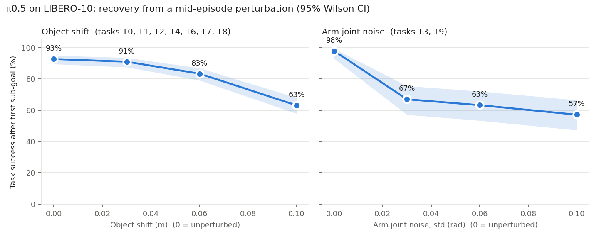
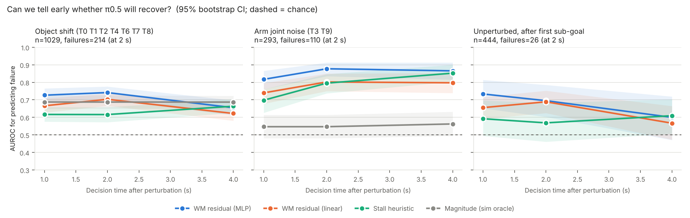
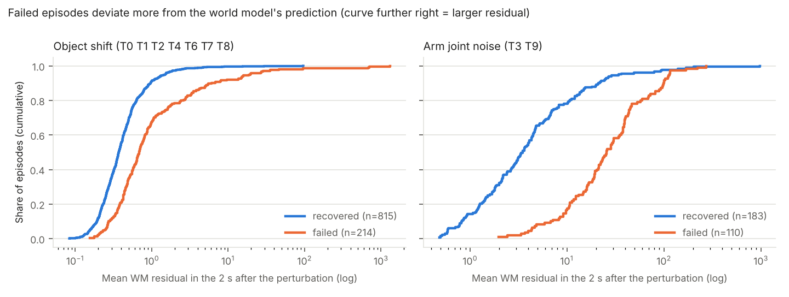

# Technical report: stage-level failure analysis and world-model failure prediction for π0.5 on LIBERO-10

← [Overview](../README.md)

## Abstract

Released VLA checkpoints are close to saturation on LIBERO (LeRobot reports
96% for π0.5 on LIBERO-10), so an aggregate success rate says little about
long-horizon robustness. I instrument the LIBERO environment to log every
BDDL sub-goal at every step, evaluate π0.5 on all 10 LIBERO-10 tasks
(50 episodes each), and add mid-episode perturbations right after the first
sub-goal is completed. **27 of 30 baseline failures occur after the first
sub-goal**, and success after a 10 cm shift of the next target object falls
from 92.8% to 63.1%. A small action-conditioned dynamics model, trained only on
successful unperturbed episodes, predicts the outcome of perturbed episodes
2 s after the perturbation with AUROC 0.74 (object shift) and 0.88 (arm
perturbation), above a stall heuristic (0.62 / 0.80). All results are from
one seed in simulation, using privileged state.

## 1. Research questions

| | Question | Section |
|---|---|---|
| RQ1 | Where in a multi-step task does π0.5 fail? | [4.1](#41-rq1-where-do-failures-happen) |
| RQ2 | How well does it recover from a disturbance after the first sub-goal? | [4.2](#42-rq2-recovery-from-a-mid-episode-perturbation) |
| RQ3 | Can a world model's prediction error tell early whether it will recover? | [4.3](#43-rq3-early-failure-prediction-with-a-world-model) |

## 2. Setup

| Item | Value |
|---|---|
| Policy | `lerobot/pi05_libero_finetuned` (π0.5 fine-tuned on LIBERO), executing 10 actions per predicted chunk |
| Benchmark | LIBERO-10 (Long), 10 tasks, LeRobot's fixed initial states, max 520 control steps at 20 Hz |
| Episodes | 50 per task and condition, seed 1000 |
| Success | LIBERO's own check: all goal predicates true at the same step |

**Tasks and sub-goals** (from the BDDL goal of each task; "at reset" = already
true at the start and therefore not counted as a completed sub-goal):

| ID | Instruction | Sub-goals |
|---|---|---|
| T0 | put both the alphabet soup and the tomato sauce in the basket | soup in basket · sauce in basket |
| T1 | put both the cream cheese box and the butter in the basket | cheese in basket · butter in basket |
| T2 | turn on the stove and put the moka pot on it | stove on · pot on stove |
| T3 | put the black bowl in the bottom drawer of the cabinet and close it | bowl in drawer · drawer closed |
| T4 | put the white mug on the left plate and the yellow-white mug on the right plate | mug 1 on plate 1 · mug 2 on plate 2 |
| T5 | pick up the book and place it in the back compartment of the caddy | book in caddy (single sub-goal) |
| T6 | put the white mug on the plate and the chocolate pudding to the right of the plate | mug on plate · pudding right of plate |
| T7 | put both the alphabet soup and the cream cheese box in the basket | soup in basket · cheese in basket |
| T8 | put both moka pots on the stove | pot 1 on stove · pot 2 on stove · (stove on: true at reset) |
| T9 | put the yellow and white mug in the microwave and close it | mug in microwave · door closed |

## 3. Method

### 3.1 Sub-goal logging

`vlalh/instrument.py` wraps LeRobot's `LiberoEnv` (`reset`, `step`, `close`)
so that the unmodified `lerobot-eval` loop can be used. At every step it
evaluates each goal predicate with LIBERO's own `_eval_predicate` and records
the end-effector pose, gripper and joint positions, the poses of all movable
goal objects, and the executed action. *First sub-goal* = the first step at
which a predicate that was false at reset becomes true.

### 3.2 Mid-episode perturbation

Five steps after the first sub-goal is completed (and only if the task is not
yet finished), one perturbation is applied directly in the MuJoCo state:

* **Object shift** (tasks whose next sub-goal involves a movable object:
  T0 T1 T2 T4 T6 T7 T8): the object is moved horizontally by 3, 6 or 10 cm in a
  uniformly random direction (seeded per episode); height and orientation are
  kept and its velocity is set to zero.
* **Arm joint noise** (tasks whose next sub-goal is closing a door or drawer:
  T3 T9): Gaussian noise with std 0.03, 0.06 or 0.10 rad is added to all 7 arm
  joints; joint velocities are set to zero.

The policy keeps running unchanged; it sees the new state from the next
observation onwards. T5 has a single sub-goal and is never perturbed.

### 3.3 World model and failure score

*Model.* A 2×256 MLP predicts Δs = s<sub>t+10</sub> − s<sub>t</sub> from the
state s<sub>t</sub>, the next 10 executed actions and a task one-hot
(`vlalh/world_model.py`). s = end-effector position (3), gripper (2), arm joints
(7), positions of up to four goal objects (12, zero-padded and masked).

*Training data.* Only **successful, unperturbed** baseline episodes with
init-state id 0–34 (333 episodes, 40k samples). Residual scales are calibrated
on the remaining successful baseline episodes (id 35–49). No perturbed episode
is used for training or calibration.

*Score.* Normalised squared prediction error, averaged over all predictions
that are complete by the decision time τ = p + W (p = perturbation step,
W = 20, 40, 80 steps = 1, 2, 4 s). This is the predict-observe-compare logic of
residual-based anomaly detection (as with the innovation of a Kalman filter).

*Comparisons.* (a) the same score with a linear (ridge) dynamics model,
(b) a stall heuristic: −(end-effector path length between p and τ),
(c) the perturbation magnitude, an oracle that exists only in simulation.

*Metric.* AUROC for "episode ends in failure", 95% bootstrap CI (1,000
resamples). Episodes that already ended before τ are excluded.

### 3.4 Design choices

| Choice | Reason |
|---|---|
| π0.5 on LIBERO-10 | Strong, openly available VLA with a LeRobot checkpoint; LIBERO-10 is the longest LIBERO suite |
| Perturb right after the first sub-goal | Isolates the long-horizon question: can the policy continue a task it has already started? |
| Train the world model on successes only | The model should describe *normal* progress; any deviation is then a candidate warning, without needing failure labels |
| AUROC | Threshold-free, robust to the class imbalance (≈ 20–40% failures) |
| Stall heuristic as baseline | Half of the baseline failures are stalls (4.1), so any learned monitor must beat this trivial rule |

## 4. Results

### 4.1 RQ1: where do failures happen?

π0.5 completes **470/500 episodes (94.0%, Wilson 95% CI 91.6–95.8)**.


* **27 of 30 failures occur after the first sub-goal**; the other 3 (all T0)
  never complete a sub-goal.
* Failures concentrate in **T8 (37/50)**. In all 13 T8 failures the first pot is
  placed at step ≈ 175–240 and the second is never placed, although successful
  episodes need ≈ 200 further steps for it and ≈ 300 remain.

Failure modes (`analysis/failure_modes.py`, heuristic and not mutually
exclusive; the T8 stall was confirmed visually, see the GIF in the overview):

| Mode | Criterion | Count (of 30) |
|---|---|---|
| Stall | end-effector moves < 15 cm in the last 150 steps | 16 |
| Carried but not placed | target object lifted > 5 cm, sub-goal still false | 6 |
| Repeated grasping | ≥ 5 gripper-close commands after the first sub-goal | 5 |
| Regression | a completed sub-goal is undone (e.g. first pot knocked off the stove) | 4 |
| No sub-goal | nothing completed | 3 |

### 4.2 RQ2: recovery from a mid-episode perturbation

Recovery rate = P(success | perturbed). Baseline = P(success | first sub-goal
reached) without perturbation, on the same tasks.

| Perturbation | Tasks | none | small | medium | large |
|---|---|---|---|---|---|
| Object shift 3 / 6 / 10 cm | T0 T1 T2 T4 T6 T7 T8 | 92.8% [89.6, 95.1] | 91.1% [87.6, 93.6] | 83.4% [79.1, 87.0] | 63.1% [57.9, 68.1] |
| Arm joint noise 0.03 / 0.06 / 0.10 rad | T3 T9 | 98.0% [93.0, 99.4] | 67.0% [57.2, 75.6] | 63.3% [53.4, 72.1] | 57.1% [47.3, 66.5] |



* 3 cm is absorbed; 6 and 10 cm are not. Sensitivity is task-dependent: at
  10 cm the basket tasks T1 and T7 still succeed 43/49 and 43/50, while T2
  (pot onto stove) falls to 21/45 and T4 (mug onto plate) to 28/50.
* Small arm perturbations while closing a drawer or door already cost about
  30 points. The two kinds differ in units and tasks and are not compared.

### 4.3 RQ3: early failure prediction with a world model

Held-out prediction quality (R², calibration episodes): MLP 0.98 for both robot
and object motion; linear model 0.83 (robot) and 0.57 (objects).

AUROC at **τ = 2 s after the perturbation**:

| Setting | n (failures) | WM, MLP | WM, linear | Stall heuristic | Magnitude (oracle) |
|---|---|---|---|---|---|
| Object shift | 1029 (214) | **0.74** [0.70, 0.78] | 0.70 [0.67, 0.74] | 0.62 [0.57, 0.66] | 0.69 [0.65, 0.73] |
| Arm joint noise | 293 (110) | **0.88** [0.84, 0.91] | 0.80 [0.75, 0.85] | 0.80 [0.74, 0.85] | 0.55 [0.48, 0.61] |
| Unperturbed, 2 s after the first sub-goal (held-out init 35–49 only) | 133 (11) | 0.56 [0.40, 0.73] | 0.65 [0.53, 0.76] | 0.46 [0.28, 0.65] | – |



* In both perturbation settings the MLP world model is the best predictor at
  1–2 s. For object shifts it is above the magnitude oracle (0.74 vs 0.69,
  CIs overlap).
* For *unperturbed* failures there are only 11 held-out cases and no predictor
  is reliably above chance. (An earlier version of this table included
  training episodes in this row and reported 0.70; that number was inflated.)
* Its advantage is **earliness**: at 4 s the stall heuristic catches up for arm
  perturbations (0.85 vs 0.87), when many failures have become visible stalls.
* A learned non-linear model matters: the linear model is worse or tied.
* It does not work everywhere: per-task AUROC is ≈ 0.6 on T6 and T8 (the task
  with most failures). A high residual means "not evolving like a successful
  episode", which also happens when the policy recovers through an unusual
  regrasp.



## 5. Validity checks

| Check | Result |
|---|---|
| Does logging change the outcome? | Stock LeRobot and instrumented runs: 470/500 each. Per-task counts differ by ≤ 2 (T3, T7). |
| Is a fixed seed reproducible? | No: π0.5 samples actions from noise. Stock re-runs of T3 gave 50/50 and 49/50 (48/50 instrumented). Hence all results are rates with CIs. |
| Physics artefacts from teleporting objects | 14 of ≈ 1,340 perturbed episodes had a > 0.15 m jump in one step (solver instability) and were excluded (`reports/perturbation/excluded_unstable.csv`). |
| Is the WM score just identifying the task or the perturbation size? | AUROC within each task × magnitude stratum: 0.73 (MLP) vs 0.59 (stall) for object shift; 0.87 vs 0.79 for arm noise. |
| Train/test leakage | WM trained only on unperturbed successes (init 0–34). Perturbed episodes were never seen in training (they share initial scenes, not trajectories). The unperturbed evaluation uses only init 35–49. |

## 6. Limitations

* One policy, one seed, simulation only.
* Sub-goal progress and the world model use privileged simulator state
  (predicates, exact object positions), which a real robot does not have.
* At 10 cm, "cannot recover" is mixed with "task became harder" (object near an
  edge or obstacle).
* LIBERO-10 tasks have two (at most three) sub-goals, short compared to
  industrial assembly sequences.
* Detection only: whether acting on the warning improves success is untested.
* No correction for multiple comparisons across the AUROC table.

## 7. Next steps

1. Visual world model: predict in image-feature space (e.g. DINO or SigLIP
   embeddings) so the monitor needs no privileged state.
2. Close the loop: on a warning, re-issue the current sub-instruction or
   re-plan, and measure recovered success against a random-trigger control.
3. Harder long-horizon settings: more seeds, LIBERO-plus perturbations, longer
   task chains, and a second policy (e.g. OpenVLA-OFT).

## 8. Reproduce

```bash
python scripts/inspect_tasks.py --suite libero_10
bash scripts/run_baseline.sh 1000 50
bash scripts/run_perturb_sweep.sh 1000 50

python analysis/analyze_stages.py outputs/baseline_seed1000 --out reports/baseline
python analysis/failure_modes.py  outputs/baseline_seed1000 --out reports/baseline
python analysis/analyze_perturbation.py --baseline outputs/baseline_seed1000 \
    --runs outputs/perturb_auto_mag0.0{3,6}_delay5_seed1000 outputs/perturb_auto_mag0.10_delay5_seed1000 \
    --out reports/perturbation
python analysis/part2_failure_monitor.py --baseline outputs/baseline_seed1000 \
    --perturbed outputs/perturb_auto_mag0.0{3,6}_delay5_seed1000 outputs/perturb_auto_mag0.10_delay5_seed1000 \
    --out reports/part2
python analysis/make_readme_figures.py
python -m pytest tests -q
```

## References

* K. Black et al., π0: A Vision-Language-Action Flow Model for General Robot Control (2024); Physical Intelligence, π0.5 (2025)
* B. Liu et al., LIBERO: Benchmarking Knowledge Transfer for Lifelong Robot Learning, arXiv:2306.03310
* *In-depth Robustness Analysis of Vision-Language-Action Models* (LIBERO-plus), arXiv:2510.13626
* LeRobot: https://github.com/huggingface/lerobot
